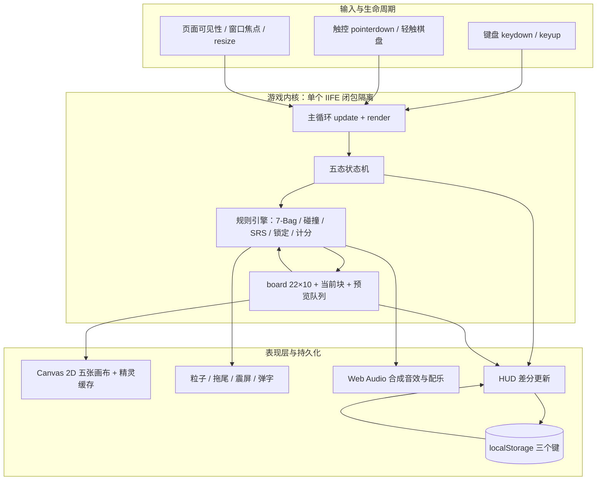
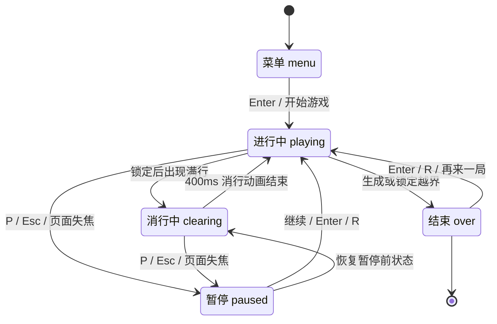
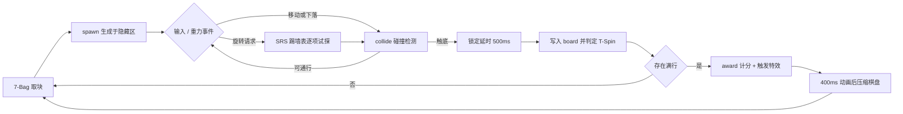

# TETRIS · 俄罗斯方块

> 单文件、零依赖的现代规则俄罗斯方块，打开浏览器即可开玩。

**单文件 · 免构建 · 纯前端 · 无服务端**

---

## 目录

[项目简介](#项目简介) · [核心能力](#核心能力) · [效果展示](#效果展示) · [应用场景](#应用场景) · [安装部署](#安装部署) · [快速开始](#快速开始) · [使用说明](#使用说明) · [系统架构](#系统架构) · [核心工作流程](#核心工作流程) · [技术栈](#技术栈) · [项目结构](#项目结构) · [配置说明](#配置说明) · [性能与扩展性](#性能与扩展性) · [安全设计](#安全设计) · [项目亮点](#项目亮点) · [Roadmap](#roadmap) · [贡献指南](#贡献指南) · [FAQ](#faq) · [License](#license)

---

## 项目简介

想玩一局俄罗斯方块，通常要先面对三种摩擦：下载安装包、跑一遍前端构建、或者打开一个只实现了「下落 + 消行」的玩具版本。前者把休闲场景变成了运维任务，后者又缺少现代俄罗斯方块真正决定手感的东西——7-Bag 随机、SRS 踢墙、Hold、幽灵块、锁定延时，以及 T-Spin、Back-to-Back、Combo 这些让技巧有回报的判定。

本项目把这两端同时解决了：**整个游戏是一个 `tetris.html`，双击即可运行，不需要 `npm install`、不需要构建、不需要服务器；但它实现的是一套完整的现代规则集**，并且配上了不依赖任何音频素材的程序化配乐、多层 Canvas 动效和桌面/移动端自适应布局。游戏逻辑、样式、渲染、音频合成全部封闭在一个 IIFE 内，唯一的网络请求是两个静态样式与字体 CDN。

它面向三类人：想立刻开一局的玩家、想读一份「Canvas + Web Audio + 状态机」完整实现的前端学习者，以及需要一个干净底座来改皮肤、加功能或做演示的开发者。项目不涉及 AI/LLM、后端与数据库，全部状态都在内存与 `localStorage` 中。

---

## 核心能力

### 完整的现代规则引擎

- **功能**：7-Bag 随机器（Fisher–Yates 洗牌，队列预填 14 个）、SRS 旋转与 J/L/S/T/Z、I 两套踢墙表、180° 旋转、Hold 每块一次、幽灵块与落点光柱、500ms 锁定延时与最多 15 次重置。
- **解决的问题**：朴素的「随机出块 + 简单矩阵旋转」会让贴墙旋转、I 块竖插和 T 块旋入都变得不可能，手感与正式规则脱节。
- **价值**：玩家学到的技巧可以迁移，而不是只适用于这个页面；`T-Spin` 采用三角判定 + 朝向角判定 + 第 5 次踢墙修正，Mini 与 Full 能正确区分。

### 有回报的计分体系

- **功能**：Single / Double / Triple / Tetris、T-Spin 与 Mini T-Spin、Back-to-Back ×1.5、Combo、Perfect Clear、软降 +1/格、硬降 +2/格，全部乘以当前等级。
- **解决的问题**：只按消行数给分的版本，玩家没有动机去做高风险的高难度操作。
- **价值**：每次判定都会触发对应的弹字、音效与边框反馈（Tetris / Perfect Clear 还伴随震屏与粒子爆发），操作与结果之间有明确因果。

### 程序化音频，零音频素材

- **功能**：基于 Web Audio API 实时合成 12 类音效；用 64 步序列实时演奏《Korobeiniki》（俄罗斯方块主题曲 A）主旋律、低音与打击层，节拍随等级从 132 BPM 提升到最高 202 BPM。
- **解决的问题**：引入音频文件会增加体积、加载等待与版权负担；用 `setInterval` 直接触发音符又会因主线程抖动而跑调。
- **价值**：采用「25ms 轮询 + 提前 150ms 预排 + 以 `AudioContext.currentTime` 为时基」的前瞻调度，节奏稳定；整包不含一个 `.mp3`/`.wav`。

### 分层 Canvas 视觉与自适应布局

- **功能**：主棋盘、Hold、Next、全屏粒子、背景浮块共 5 张 Canvas；方块精灵离屏预渲染并缓存；CSS 负责霓虹渐变边框、毛玻璃面板、透视网格地面与危险区呼吸光。
- **解决的问题**：每帧用渐变 + 圆角重画 200 个方块开销过高；固定像素布局在手机上会直接溢出。
- **价值**：`layout()` 依据视口宽高反推格子尺寸（12–38px），窄屏自动把数据面板移到顶部并隐藏键位表，触屏设备另外显示虚拟键盘；DPR 上限 2 以控制填充量。

### 一致的桌面 / 移动操作体验

- **功能**：键盘采用自实现 DAS 160ms / ARR 33ms（刻意忽略系统 `e.repeat`）；触屏提供虚拟按键、轻触棋盘顺时针旋转与振动反馈；标签页隐藏或窗口失焦自动暂停。
- **解决的问题**：依赖操作系统按键重复率会让不同机器的横移速度不一致；切走窗口后重力继续累积会导致回来时已经 Game Over。
- **价值**：手感与浏览器、设备、系统设置解耦，且不会因为一次切换标签页毁掉一局。

---

## 效果展示

界面布局示意（桌面宽屏）：

```text
┌──────────────────────────────────────────────────────────────┐
│  ◆ T E T R I S          俄罗斯方块         ♪   🔊   ⏸        │
├────────────┬────────────────────────────┬────────────────────┤
│  HOLD      │                            │  NEXT              │
│  ┌──────┐  │                            │  ┌──────┐          │
│  └──────┘  │      10 × 20 主棋盘        │  └──────┘  + 4 预览 │
│            │   幽灵块 / 落点光柱 / 拖尾  │                    │
│  分数      │                            │  KEYS              │
│  最高      │      TETRIS!  +800          │  ← → 移动          │
│  等级 ▓▓   │                            │  SPACE 硬降 …      │
│  消行/时间  │                            │                    │
└────────────┴────────────────────────────┴────────────────────┘
   背景：渐变光晕 + 透视网格地面 + 缓慢上浮的半透明方块
```

**输入示例**（等级 1，硬降 12 格后一次消满 4 行）：

```text
↑   → 调整姿态
SPACE → 硬降
```

**输出示例**：

```text
硬降得分        12 × 2 = +24
棋盘弹字        TETRIS / +800
音频            七音上行琶音 + 低频冲击 + 高频噪声扫频
视觉            紫色边框闪烁、消行粒子爆发、轻微震屏、等级进度条推进
```

<!-- TODO: 添加游戏截图或 GIF（建议放在 docs/screenshot.png 并在上方引用） -->

---

## 应用场景

- **即时休闲**：拿到一个 HTML 文件就能在任意设备的浏览器里开局，无需账号、无需联网安装，适合离线环境或受限网络。
- **前端教学案例**：一份可读的封闭实现，覆盖状态机、固定时间步的游戏循环、碰撞检测、SRS 坐标变换、Canvas 离屏缓存、Web Audio 合成与响应式布局，且没有框架噪声。
- **作品集 / 技术评审素材**：能在一次代码走查中展示算法（踢墙表、T-Spin 三角判定）、渲染优化（精灵缓存、差分 HUD）和工程取舍（零构建、闭包隔离）。
- **二次开发底座**：规则、渲染、音频分区清晰，适合改主题、加键位配置、接排行榜或抽出纯函数规则引擎做单元测试。
- **移动端触屏游戏**：`pointer: coarse` 设备自动切换为虚拟键盘布局，横竖屏与视口变化由 `layout()` 重算，无需单独维护移动版页面。

---

## 安装部署

### 环境要求

| 项目 | 要求 |
|------|------|
| 运行环境 | 任意现代浏览器（近三年的 Chrome / Edge / Firefox / Safari 桌面与移动版） |
| 所需 API | Canvas 2D、Web Audio API、Pointer Events、CSS `backdrop-filter`、`matchMedia` |
| 可选 | Python 3（本地静态服务）、Docker（容器托管） |
| 依赖 | **无 npm 包、无构建步骤、无环境变量、无数据库、无后端** |
| 网络 | 仅首次加载 Google Fonts（Orbitron / Rajdhani）与 cdnjs 的 Font Awesome 6.5.1 样式；缺失时游戏逻辑照常运行，仅字体与图标降级 |

> 建议用本地 HTTP 服务打开，而不是直接双击 `file://`。在 `file://` 协议下部分浏览器会限制 `localStorage`，导致最高分无法持久化（见 [FAQ](#faq)）。

### 方式一：让 AI 帮你准备好（最简单）

把下面这段提示词直接粘贴给你的 AI 编码工具：

```text
请帮我在当前目录准备好这个俄罗斯方块项目：
1. 确认目录中存在 tetris.html（单文件游戏，无需安装依赖、无需构建）。
2. 用 Python 启动本地静态服务：python3 -m http.server 8000。
3. 打开 http://localhost:8000/tetris.html，确认出现 TETRIS 开始界面。
4. 完成后把访问地址和验证结果告诉我。
```

### 方式二：命令行一键启动

```bash
# 已有仓库时
cd 俄罗斯方块

# 或克隆（把地址替换为你的仓库地址）
# git clone https://github.com/<your-username>/俄罗斯方块.git && cd 俄罗斯方块

python3 -m http.server 8000
# 浏览器访问 http://localhost:8000/tetris.html
```

也可以让系统默认浏览器直接打开：

```bash
open tetris.html            # macOS
xdg-open tetris.html        # Linux
start tetris.html           # Windows (cmd)
```

可选：用容器托管静态文件（适合内网演示）：

```bash
docker run --rm -p 8080:80 -v "$PWD":/usr/share/nginx/html:ro nginx:alpine
# 浏览器访问 http://localhost:8080/tetris.html
```

### 方式三：手动安装

1. 下载或复制 `tetris.html` 到本地任意目录（约 60 KB，单文件）。
2. 双击用浏览器打开，或拖入浏览器窗口。
3. 看到 `TETRIS / 经典方块 · 精致复刻` 开始界面即安装成功。

### 验证

```bash
curl -sI http://localhost:8000/tetris.html | grep "200 OK"
```

浏览器侧检查：出现开始遮罩 → 按 `Enter` → `NEXT` 面板出现 5 个预览块 → 按 `←` / `→` 当前块横向移动 → 按 `SPACE` 硬降并产生音效。

---

## 快速开始

```bash
cd 俄罗斯方块 && python3 -m http.server 8000
# 打开 http://localhost:8000/tetris.html，按 Enter 开局
```

安装与环境细节见[上一节](#安装部署)。

---

## 使用说明

### 键盘操作

| 按键 | 动作 | 备注 |
|------|------|------|
| `←` `→` | 左右移动 | 长按触发 DAS 160ms / ARR 33ms |
| `↓` | 软降 | 每格 +1 分，软降间隔 28ms |
| `SPACE` | 硬降 | 每格 +2 分，立即锁定 |
| `↑` / `X` | 顺时针旋转 | SRS 踢墙 |
| `Z` / `Ctrl` | 逆时针旋转 | `Ctrl` 为未在界面列出的备用键 |
| `A` | 旋转 180° | 使用独立的 `K_180` 偏移表 |
| `C` / `Shift` | 暂存（Hold） | 每个方块仅可暂存一次 |
| `P` / `ESC` | 暂停 / 继续 | |
| `M` | 开关背景音乐 | 设置写入 `localStorage` |
| `Enter` | 开始 / 继续 / 再来一局 | |
| `R` | 重新开始 | 仅在暂停或结束状态生效 |

界面上的 `KEYS` 面板展示的是常用键位；`Ctrl`、`Shift`、`R` 属于实现的备用键，未全部列出。

### 触屏操作

在 `(pointer: coarse)` 设备上会自动显示虚拟键盘：左侧 `HOLD` 与方向键（含软降），右侧逆时针 / 顺时针旋转与 `DROP` 硬降；**直接轻触主棋盘也可顺时针旋转**。按键按下时触发 `navigator.vibrate` 轻振动，按钮使用 `setPointerCapture` 避免手指滑出后卡住连发状态。

### 一局流程

1. 开始界面展示装饰性堆叠（由 `demoBoard()` 生成）与历史最高分。
2. 按 `Enter` 或点击「开始游戏」→ 清空棋盘、重置 7-Bag 队列、初始化 `AudioContext`、启动配乐。
3. 游戏中 HOLD / NEXT / 分数 / 等级 / 消行 / 用时实时更新；堆叠触及棋盘顶部 6 行（含 2 行隐藏区）时边框进入危险呼吸光。
4. 消行时进入 `clearing` 状态播放 400ms 动画，判分与弹字在动画开始前完成。
5. 生成位置或锁定位置越界 → 逐行灰化动画（约 1.1s）→ 1.3s 后弹出结算面板（最终得分、等级、消行、用时、新纪录标记）。

### 计分规则

所有基础分最终乘以当前等级；`Combo` 与 `Perfect Clear` 是额外加分，也各自乘以等级；软降 / 硬降直接加分，不乘等级。

| 判定 | 基础分（等级 1） |
|------|------------------|
| Single / Double / Triple / Tetris | 100 / 300 / 500 / 800 |
| T-Spin（0 / 1 / 2 / 3 行） | 400 / 800 / 1200 / 1600 |
| Mini T-Spin（0 / 1 / 2 / 3 行） | 100 / 200 / 400 / 400 |
| Back-to-Back | 基础分 × 1.5（连续 Tetris 或带消行的 T-Spin） |
| Combo ×n | 额外 `50 × n × 等级` |
| Perfect Clear（1 / 2 / 3 / 4 行） | 额外 800 / 1200 / 1800 / 2000 |
| 软降 / 硬降 | 每格 +1 / +2 |

等级每消 10 行提升 1 级；重力间隔遵循 `(0.8 − (lv−1)×0.007)^(lv−1) × 1000` 毫秒（重力计算上限取到第 20 级），配乐节拍随之加快。

---

## 系统架构

项目是**单文件部署、逻辑分层**的结构：所有代码在同一个 IIFE 内，靠闭包隔离出音频系统、规则引擎、渲染、特效、HUD 与输入六个职责区，避免污染全局作用域，也省掉了模块打包器。不存在 AI/LLM、后端服务、数据库或构建产物。



| 模块 | 职责 | 关键设计 |
|------|------|----------|
| 输入层 | 把键盘、触控、生命周期事件归一为动作 | 忽略系统 `e.repeat`，DAS/ARR 由主循环计时实现；失焦自动暂停并清空按键状态 |
| 主循环 | `requestAnimationFrame` 驱动 `update(dt)` 与 `render()` | `dt` 钳制到 50ms，避免切回标签页后重力一次性爆发 |
| 状态机 | `menu / playing / clearing / paused / over` | 消行动画与暂停恢复都保留前序状态，避免逻辑重入 |
| 规则引擎 | 出块、碰撞、旋转踢墙、锁定、T-Spin、计分 | 形状由 7 个基础矩阵预生成 4 个朝向的坐标列表，碰撞只遍历 4 个格子 |
| 棋盘状态 | `board[22][10]`（20 可见 + 2 隐藏行）、当前块、14 个预填队列 | 隐藏行使生成与越界判定不必写特例 |
| 渲染层 | 5 张 Canvas 分工绘制 | 棋盘底图与方块精灵离屏预渲染，以 `type` 与 `size` 组合为缓存键，仅 `layout()` 时重建 |
| 特效层 | 硬降拖尾、锁定闪光、消行粒子、屏幕震动、CSS 弹字 | 全屏粒子画布与主棋盘解耦，粒子数量上限 900 |
| 音频层 | 合成全部音效与配乐 | master → 动态压缩器；音乐总线另接 2600Hz 低通，与音效分轨 |
| 持久化 | 最高分与音频开关 | 仅 3 个 `localStorage` 键，无任何服务端同步 |

### 五态状态机



`togglePause()` 会把当前状态存入 `prevState`，因此「在消行动画中暂停」恢复后仍能正确回到 `clearing`。

---

## 核心工作流程

一个方块从出块到结算的完整链路：



1. **取块与生成** — `fillQueue()` 保证队列始终有 14 个方块，每次洗一个完整的 7 种排列；`takeNext()` 出队后立即补充。`spawn()` 把方块放在隐藏行并在两个候选位置检查碰撞，失败即判定结束。**输入**：队列；**输出**：`{type, rot, x, y, lowest}`。
2. **操作与碰撞** — 移动、软降、重力都经过 `collide()`；旋转按 `from>to` 查 `K_JLSTZ` / `K_I`（或 180° 的 `K_180`），依次尝试最多 5 个偏移，第一个不碰撞的即生效。**关键点**：踢墙表使用「y 轴向上」，代码中以 `cur.y - offset[1]` 转换到屏幕坐标。
3. **锁定延时** — 触底后累计 `lockTimer`，达到 500ms 或发生硬降时锁定。移动 / 旋转可重置计时，但受 `MAX_RESETS = 15` 限制，且方块降到新的最低行时计数清零，避免无限旋转赖场。
4. **判定与计分** — 锁定瞬间把 4 个格子写入 `board`，先做 T-Spin（三角占据 + 朝向角，第 5 次踢墙强制判 Full），再检查满行与 Perfect Clear（满行之外棋盘必须全空），最后 `award()` 汇总 B2B、Combo、等级与弹字。
5. **消行与续局** — 有满行则切到 `clearing` 播放 400ms 动画，`finishClear()` 用 `filter` 移除行并在顶部 `unshift` 空行；无满行直接 `spawnNext()` 并重置 Hold 权限。

---

## 技术栈

| 层级 | 技术 | 用途 | 选型理由 |
|------|------|------|----------|
| 文档结构 | HTML5 单文件 | 结构、样式、脚本与 DOM 全在一起 | 分发成本降为一个文件，双击即可运行 |
| 界面样式 | CSS3（自定义属性、渐变、`backdrop-filter`、关键帧动画） | 霓虹主题、毛玻璃面板、透视地面、弹字与边框反馈 | 纯 CSS 承担静态装饰，减少每帧 Canvas 绘制量；`--cell` 变量让所有尺寸随格子缩放 |
| 业务逻辑 | 原生 JavaScript（ES6+，IIFE + `'use strict'`） | 状态机、规则引擎、输入与主循环 | 无框架、无转译、无依赖；闭包天然隔离模块作用域 |
| 图形渲染 | Canvas 2D + 离屏 Canvas 精灵缓存 | 主棋盘、Hold/Next 预览、粒子、背景浮块 | 200 格重绘用 `drawImage` 贴缓存位图，比逐格画渐变更稳 |
| 音频 | Web Audio API（Oscillator / BufferSource / BiquadFilter / DynamicsCompressor） | 12 类音效 + 64 步程序化配乐 | 无需音频素材，且能以 `currentTime` 精确排程，避免计时器抖动 |
| 输入 | KeyboardEvent、Pointer Events、`matchMedia`、`navigator.vibrate` | 键盘、触屏、设备能力探测、振动反馈 | Pointer Events 统一鼠标/触摸，`setPointerCapture` 防止按键卡住 |
| 持久化 | `localStorage` | `tt_best` / `tt_music` / `tt_sfx` | 数据量极小，无需后端即可跨会话保留 |
| 外部资源 | Google Fonts（Orbitron / Rajdhani）、cdnjs Font Awesome 6.5.1 | 标题字体与按钮图标 | 仅静态 CSS/字体，缺失时功能不受影响 |
| 构建与部署 | 无构建；可选 `python3 -m http.server` 或 `nginx:alpine` 静态托管 | 本地运行 / 容器演示 | 没有需要编译、打包或注入环境变量的产物 |

---

## 项目结构

仓库刻意保持极简，没有 `src/`、`package.json`、构建脚本或测试目录：

```text
俄罗斯方块/
├── tetris.html     # 全部内容：DOM + CSS + 游戏逻辑（约 60 KB / 1245 行）
└── README.md       # 本文档
```

单文件内部按职责顺序分区，直接搜索注释标题即可定位：

| 行区间 | 分区 | 内容 |
|--------|------|------|
| 12–175 | `CSS` | 背景与光晕、布局、棋盘边框、遮罩、弹字、触控键盘、窄屏适配 |
| 178–295 | `DOM` | 顶栏、左右侧栏、主棋盘、三种遮罩、虚拟按键 |
| 301–347 | `Constants` | 尺寸与手感常量、7 种形状矩阵、4 朝向预生成、SRS 踢墙表、重力公式 |
| 349–478 | `Audio` | `AudioSys` 闭包：音频图、音效集合、Korobeiniki 序列、前瞻调度器 |
| 481–601 | `DOM / Canvas` | 圆角路径、DPR 画布、方块精灵生成与缓存、棋盘底图、响应式 `layout()` |
| 603–836 | `Game State` | 棋盘与队列、碰撞、生成、移动/旋转/硬降/Hold、T-Spin、锁定、计分、状态切换 |
| 838–941 | `Effects` | 弹字、拖尾、粒子、震动、背景浮块 |
| 943–1081 | `Rendering` | 预览绘制、危险区、已落块、光柱、幽灵块、锁定进度、消行动画 |
| 1083–1117 | `HUD` | 差分文本更新、时间格式化、遮罩与按钮状态 |
| 1119–1188 | `Input` | 键位映射、DAS/ARR、触控事件、按钮点击、自动暂停 |
| 1190–1228 | `Loop` | `update(dt)` 与 `loop(t)` 主循环 |
| 1230–1241 | `Bootstrap` | 开始界面装饰堆叠、初始化与启动 |

---

## 配置说明

项目没有 `.env`、配置文件或运行时设置面板；可调整项都是 `tetris.html` 内 `<script>` 顶部的常量，修改后刷新页面即可生效。

| 常量 | 默认值 | 说明 |
|------|--------|------|
| `COLS` / `ROWS` / `HIDDEN` | `10` / `20` / `2` | 可见列数、可见行数、顶部隐藏行数（合计 22 行） |
| `DAS` / `ARR` | `160` / `33` ms | 长按首次延迟、之后每格重复间隔 |
| `SOFT_MS` | `28` ms | 软降间隔（与当前重力取较小值） |
| `LOCK_DELAY` / `MAX_RESETS` | `500` ms / `15` 次 | 锁定延时与最大重置次数 |
| `CLEAR_MS` / `TRAIL_MS` / `FLASH_MS` | `400` / `260` / `200` ms | 消行动画、硬降拖尾、锁定闪光的时长 |
| `COLORS` | 7 种方块色 + 灰色 `G` | 方块配色；同时用于精灵、粒子与光柱 |
| `gravityMs(lv)` | 官方指南公式 | 每级重力间隔，实际计算封顶第 20 级 |
| `MEL` / `BASS` / `stepDur()` | 64 步 / 8 个根音 / 132 BPM 起 | 配乐旋律、低音进行与随等级变化的节拍 |
| `narrow` 阈值 | `vw < 760` | 切换到窄屏布局的视口宽度 |
| `dpr` 上限 | `2` | 高分屏像素比封顶，控制填充开销 |

浏览器端持久化键（无服务端同步）：

| 键名 | 默认值 | 说明 |
|------|--------|------|
| `tt_best` | `0` | 历史最高分，仅在游戏结束且刷新纪录时写入 |
| `tt_music` | 开启（值不为 `'0'`） | 背景音乐开关 |
| `tt_sfx` | 开启（值不为 `'0'`） | 音效开关 |

---

## 性能与扩展性

**已做的优化**

- **离屏缓存**：棋盘底图只在 `layout()` 时重建一次；方块精灵按 `type|size` 缓存，每帧主棋盘只是 200 次 `drawImage`。
- **差分 HUD**：`setText()` 先比较旧值，只有变化才写 DOM；分数用插值平滑，避免每帧触发文本布局。
- **特效有界**：粒子数组上限 900；`fxDirty` 保证没有粒子时不再每帧 `clearRect` 全屏画布。
- **时间步安全**：`dt = Math.min(50, t - last)`；配合失焦自动暂停，切标签页回来不会一次性下落十几行。
- **音频稳定性**：25ms 轮询、提前 150ms 用 `AudioContext.currentTime` 排程；每个振荡器播完即 `stop()` 释放，不积累节点。
- **像素比封顶**：`dpr ≤ 2`，避免 3× 屏上 9 倍像素填充。

**瓶颈与成本**

- `render()` 每帧全量重绘主画布；当前块的 `shadowBlur`、多处 `backdrop-filter` 与背景浮块是主要 GPU 开销，低配设备会先在这里掉帧。
- 配乐每 8 分音符创建 3–4 个振荡器节点；这是单页小游戏里最重的持续 CPU/音频线程成本，关闭音乐即可完全消除。
- 项目为纯客户端，没有网络、存储或第三方服务成本；分发成本就是 60 KB 静态文件。

**扩展方向**

1. 把常量与键位映射抽成可持久化的设置面板（DAS/ARR、音量、主题色、粒子开关）。
2. 将 `RULES` 部分抽为不依赖 DOM 的纯函数模块，接入单元测试与录像回放（记录操作序列 + 随机种子）。
3. 本地化字体与图标，做成完全离线的 PWA，并为 CDN 资源加固定版本 / SRI。
4. 若要联机对战或在线排行榜，再引入服务端；建议保留当前规则引擎为共享的纯逻辑层，两端复用。
5. 接入 GitHub Pages / 任意静态托管即可发布，无需改动源码。

---

## 安全设计

- **无攻击面主体**：没有服务端、API、账号体系、数据库或表单提交；不发送任何业务请求，页面不读取用户输入以外的浏览器数据。
- **外部资源受控**：仅通过 `<link>` 加载 Google Fonts 与 cdnjs 的 CSS/字体，**不加载任何第三方脚本**。当前未使用 SRI 校验，若作为正式站点分发，建议把这两项资源自托管并固定版本，以消除 CDN 供应链风险。
- **数据本地化**：`localStorage` 只存 `tt_best`、`tt_music`、`tt_sfx` 三个标量，不含个人信息，也不跨站点同步；清除浏览器数据即可完全抹除。
- **DOM 注入面**：代码中 `innerHTML` 仅用于写入硬编码的 Font Awesome 图标标签（音效按钮、暂停按钮）或清空弹字容器，没有拼接任何外部字符串；弹字内容使用 `textContent`，因此不存在可控的 HTML 注入路径。
- **浏览器策略合规**：`AudioContext` 只在首次用户交互后 `init()` / `resume()`，符合自动播放策略；键盘事件的 `preventDefault()` 只作用于方向键、空格与 `Enter`，不拦截浏览器安全快捷键。
- **协议注意**：`file://` 下 `localStorage` 行为因浏览器而异，某些配置会抛 `SecurityError`；用本地 HTTP 服务打开是更稳妥的方式。

---

## 项目亮点

**技术创新**

- 在纯前端里实现完整的 SRS 踢墙表、180° 旋转与 T-Spin 三角判定，并把「最后一次踢墙」纳入 Full/Mini 区分，而非只做形状旋转。
- 用 Web Audio 从零合成整首《Korobeiniki》与 12 类音效，采用 `currentTime` 前瞻调度解决 JS 计时器抖动；节拍还能随等级联动加速。
- 形状矩阵预生成 4 个朝向的坐标列表 + 隐藏行设计，让碰撞、渲染、预览、T-Spin 共用同一份数据，避免多处维护坐标特例。

**工程创新**

- 一个 60 KB 文件覆盖全部功能，零依赖、零构建、零配置；同时用 IIFE 与分区注释维持了模块化可读性，没有退化成一团全局变量。
- 主循环统一处理 DAS/ARR、重力、锁定延时与动画计时，不依赖系统按键重复率；`dt` 钳制 + 失焦自动暂停使状态机在真实浏览器环境中保持自洽。
- 精灵缓存、差分 HUD、粒子上限与 `fxDirty` 早退，是在没有性能分析工具的小项目里做的一组明确、可解释的优化取舍。

**产品创新**

- 把竞技向规则（Hold、5 个 NEXT、幽灵块、T-Spin / B2B / Combo / Perfect Clear）与即时视觉反馈（弹字、专属音效、边框闪烁、震屏、危险区呼吸光）配齐，让「做对了一个高难操作」有可感知的回报。
- 同一份代码通过 `layout()` 与 `pointer: coarse` 自动适配桌面与手机：窄屏重排数据面板、隐藏键位表、显示虚拟键盘并支持轻触棋盘旋转。

---

## Roadmap

- [x] 7-Bag 随机、SRS 踢墙、180° 旋转、Hold、幽灵块与落点光柱
- [x] T-Spin / Mini T-Spin / Back-to-Back / Combo / Perfect Clear 计分
- [x] Web Audio 程序化配乐与全套音效
- [x] 桌面键盘 + 移动触控 + 响应式布局
- [x] 最高分持久化、危险区提示、自动暂停
- [ ] 补充 `LICENSE` 与游戏截图 / GIF
- [ ] 键位、DAS/ARR、音量与特效强度的设置面板
- [ ] 字体与图标本地化，实现完全离线（含 SRI 或自托管）
- [ ] 规则引擎单元测试、操作录像回放与种子复现
- [ ] GitHub Pages 演示页与静态站点部署

> 未勾选项是基于当前代码缺口给出的建议方向，不是既定交付承诺。

---

## 贡献指南

### 本地开发

1. Fork 仓库并克隆到本地。
2. 直接在编辑器打开 `tetris.html`（无需安装依赖）；用 `python3 -m http.server 8000` 启动后访问 `http://localhost:8000/tetris.html`。
3. 修改后刷新浏览器即可看到效果；建议同时打开 DevTools Console 检查运行时报错。

### 代码规范

- 保持单文件、零依赖、零构建；不要引入框架或 npm 包，除非议题已充分讨论。
- 沿用现有风格：2 空格缩进、单引号、语句末尾分号、逻辑分区用 `/* ===== ... ===== */` 注释标出。
- 全局状态集中在 `Game State` 分区；新效果优先放进 `Effects` / `Rendering`，不要在规则函数里直接操作 DOM。
- 新增可配置参数时放进顶部 `Constants`，并同步更新本 README 的「配置说明」表。

### 提交与 PR

- 提交信息使用 Conventional Commits：`feat: ...`、`fix: ...`、`perf: ...`、`docs: ...`。
- 一个 PR 聚焦一件事，说明改动动机与验证方式；涉及规则（旋转、锁定、计分）的改动请附上复现步骤或录屏。
- 仓库目前**没有自动化测试与 CI**，提交前请按下面清单手动验证：
  - 桌面：开局 → 左右长按 DAS/ARR → 四向旋转（含贴墙踢墙与 180°）→ Hold 单块限制 → 硬降 → 消行 → 暂停 / 切标签页 → 结束与再开局；
  - 计分：至少各触发一次 Tetris、T-Spin、Combo、Perfect Clear，核对弹字与分数；
  - 移动端：窄屏布局不溢出、虚拟按键无卡住连发、轻触棋盘可旋转、旋屏后 `layout()` 正常重算；
  - 音频：开关音乐 / 音效、刷新后设置保持、升级后节拍加快。

### Issue

请注明浏览器与版本、桌面还是移动设备、复现步骤、期望与实际行为；附上截图或录屏会显著加快定位。

---

## FAQ

### 需要 `npm install` 或打包吗？

不需要。项目没有 `package.json`、没有构建脚本、没有依赖。下载 `tetris.html` 用浏览器打开即可；只有想让最高分可靠持久化时，才建议起一个本地静态服务。

### 完全断网能玩吗？

游戏逻辑、渲染和音频都来自文件本身与浏览器 API，断网可玩。但标题字体（Orbitron / Rajdhani）与按钮图标（Font Awesome）来自 CDN，断网时会回退到系统字体且图标可能显示为空白，**按键功能不受影响**。如需彻底离线，把这两份资源下载到本地并改写 `<head>` 中的两个 `<link>`。

### 最高分每次打开都变回 0？

多半是用 `file://` 直接打开的。部分浏览器把本地文件视为不透明来源，会限制或隔离 `localStorage`。改用 `python3 -m http.server 8000` 并访问 `http://localhost:8000/tetris.html` 即可；另外请确认没有禁用站点数据或用隐私模式打开。

### 打开页面没有声音？

浏览器自动播放策略要求先有用户交互。`AudioSys.init()` 在第一次按键或点击时才创建并 `resume()` `AudioContext`，所以请先按 `Enter` 或点击「开始游戏」。若仍无声，检查顶栏的音乐 / 音效按钮是否处于关闭态（图标带斜线），以及系统是否静音了当前标签页。

### 手机上怎么玩？棋盘会不会太小？

`matchMedia('(pointer: coarse)')` 命中时会自动显示虚拟按键，并把数据面板移到棋盘上方、隐藏键位表。`layout()` 会根据视口高度和宽度共同反推格子尺寸（下限 12px），旋屏或改窗口大小都会重算。最稳妥的是竖屏持握并允许浏览器全屏；直接轻触主棋盘可以顺时针旋转，省去够右侧按钮。

### 支持 T-Spin 和 7-Bag 吗？和竞技版还差什么？

两者都支持，另外还有 SRS 踢墙、Hold、锁定延时与完整的 B2B / Combo / Perfect Clear 计分。项目定位是「单文件现代规则复刻」，**没有实现** ARE（入场延迟）、IRS（生成时预旋转）、20G 重力、对战垃圾行与联机排行榜，也没有在线排行榜或设置面板；这些都在 [Roadmap](#roadmap) 中列为可选方向。

---

## License

**仓库当前尚未包含 `LICENSE` 文件。** 在维护者补充许可证之前，代码默认受著作权保护，请勿默认按开源许可证进行二次分发或商用；建议尽快补充 `LICENSE`（如 MIT 或 Apache-2.0）并在本节省注明类型与关键约束。

此外，页面引用的第三方资源有各自的许可要求：Google Fonts 的 Orbitron / Rajdhani 与 Font Awesome Free 6.5.1 在**自托管或随项目再分发**时需遵循对应字体 / 图标许可与署名要求。仅通过 CDN 链接引用不等同于再分发；如需完全离线打包，请先核对上游的最新许可条款。

<!-- TODO: 补充 LICENSE 文件后，将本节替换为许可证名称与 LICENSE 链接 -->
